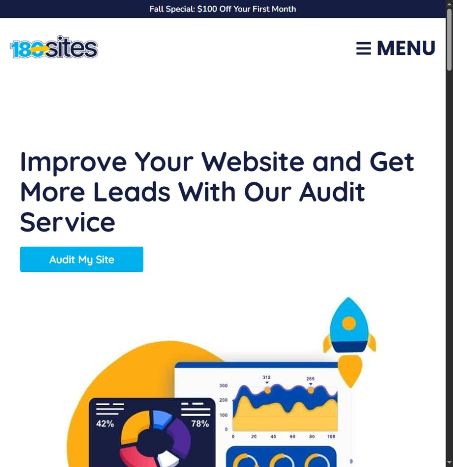
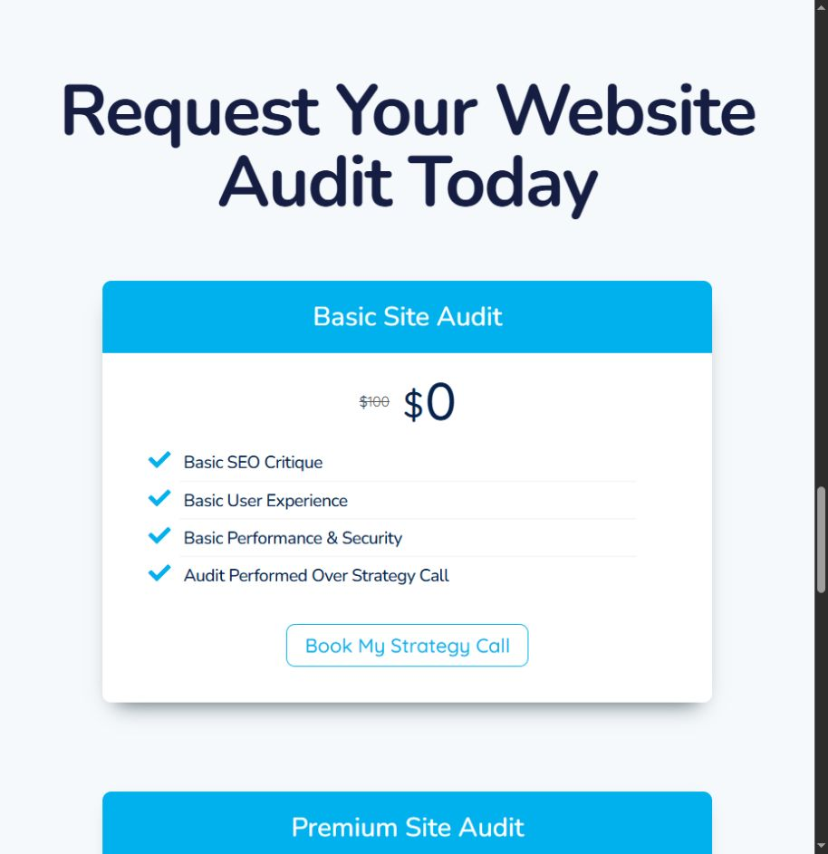

# 180 Sites discovery

> Reference evidence (2026-10-23). For current product decisions and instructions, start with [the workspace documentation](../../../README.md). Observations, recommendations and vendor claims retain the qualifications below.

Reviewed October 23, 2026. Content review of selected buying-journey, industry and portfolio pages; browser inspection of the audit flow. See `PAGE_REVIEW.md` for the page-by-page register, `coverage.json` for exact retrieval coverage and `url-inventory.json` for discovered URLs. Judgments below concern clarity and likely friction; conversion effectiveness was not measured.

## Core lesson

180 Sites productizes delivery through templates, page-count packages, a repeatable onboarding process and an extended payment schedule. The recurring charge includes repayment of the website build. It is not simply cancellable monthly maintenance.

## Buying journey

1. [Home](https://180sites.com/) identifies home-service businesses, introduces a monthly starting price and directs visitors to pricing or a conversation. Strong audience recognition; the aggressive competitor comparisons and promised financial benefits should not be imported as facts.
2. [Pricing](https://180sites.com/pricing/) offers Starter $195/month for 5 pages, Deluxe $250 for 10, Premium $300 for 20. All are advertised on 24-month plans. Calculated base commitments are $4,680, $6,000 and $7,200 before extras/taxes. Content and extra pages are separately priced; fully custom design is a $2,500 upgrade. This is useful packaging clarity, but a monthly headline alone understates the decision.
3. [Get started](https://180sites.com/get-started/) asks first/last name, email, phone, business name and optional web address. It promises an email response rather than an immediate result. Biz Da Vinci should put this contact step after free output.
4. [How it works](https://180sites.com/how-it-works/) explains package → signup → company information → development → revisions → launch → maintenance. This reduces process uncertainty. Its optimistic 30-day headline is qualified by a 4–6 week average in the FAQ; use one consistent timing explanation in our product.
5. [Management](https://180sites.com/website-management/) makes ongoing care tangible through backups, updates, monitoring and sample reports. The two-year free-care wording describes inclusion with paid website packages. Some monitoring intervals differ within the page. Biz Da Vinci should say “included” and define service levels consistently.
6. [FAQ](https://180sites.com/faqs/) explains ownership after payment, a 50% remaining-balance cancellation fee, full repayment to take the site, and a $150/month post-term maintenance option. These commercial conditions belong near plan selection, not only in FAQs.
7. [Terms](https://180sites.com/terms-and-conditions/) state the 24-month commitment and initial 30-day cancellation/refund window. Cancellation wording is less nuanced than the FAQ. Record the discrepancy as a clarity issue; this research does not decide legal enforceability.

## Free audit: value and gate

The [audit page](https://180sites.com/audit/) defines four useful categories: usability, lead actions, search visibility and performance. Its basic audit is shown at $0 and performed on a strategy call. The $200 premium option promises a video and recommendations delivered in 1–4 days. Free does not mean immediate or self-service.

The category breakdown and actionable deliverable are worth adopting. Requiring a strategy call before the free assessment conflicts with Biz Da Vinci's requested experience. Some PDF/video FAQ terminology is not aligned cleanly with the displayed package names, another reason to define each deliverable precisely.

## What to adopt

- Standardize production behind the scenes, while adapting content and customer actions by profession.
- Show page allowances, content responsibilities, updates and add-ons explicitly.
- Explain the entire handoff and launch process before purchase.
- Make ongoing care visible with a work log and readable report.

## What to change for Biz Da Vinci

- Give an actual audit result before a call or contact form.
- Separate the project price, payment schedule and ongoing maintenance fee.
- Put ownership, minimum term, exit rules and total commitment on the plan card or immediately beneath it.
- Avoid unsupported statements that a website will pay for itself or automatically create more leads.
- Use relevant examples without inheriting the competitor's home-services-only emphasis; the Tampa list includes many other professions.

## Limits

The paid onboarding, payment portals and actual service delivery were not tested. Testimonials and portfolio outcomes are vendor evidence, not independently validated performance. The screenshot viewport was approximately 914 by 943 pixels; this is not a comprehensive mobile or accessibility audit. Broader blog and portfolio archives are inventoried separately and must not be described as fully reviewed.
