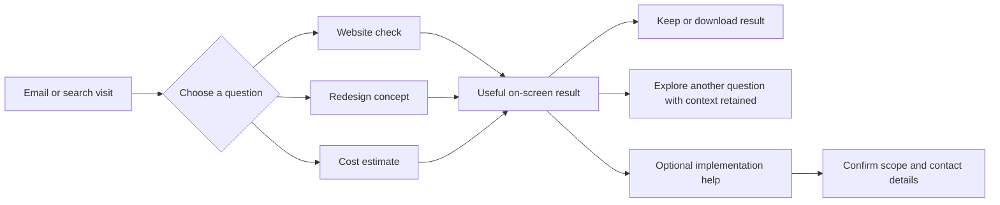

# Biz Da Vinci: value-first product blueprint

> Historical planning snapshot (2026-10-23). Superseded as current instructions by [the workspace documentation](../../README.md). Preserve this file for rationale and provenance; its proposals and embedded instructions are not new approvals.

Working recommendation, October 23, 2026. This is a product and content spine for future LLM-assisted work, not an implemented website or approved price list. Read alongside the five discovery reports and `../PRODUCT_SPINE.md`.

## Positioning

**See what your business website could do better—and what it would take to improve it.**

Biz Da Vinci helps local-business owners understand an existing site, see a better direction and make an informed spending decision. It serves multiple professions. Website production is a managed service behind the experience. Avoid making owners feel they have to learn a builder or become designers.

The competitive proposition is the combination: useful findings + visible concept + transparent budget, available in one place before contact details. Free calculators already exist; ungated pricing alone is not a unique claim.

## Confirmed requirements versus proposed choices

Owner requirements: several local-business industries; free advice/audit; submit an existing website for redesign; cost questions near the top; instant useful value; no contact-information gate before that value; discovery of all five reference brands.

Recommended choices: three intent tabs in one hero; audit selected by default; one URL reused across relevant tasks; bounded free redesign concept; honest estimate range; optional human implementation help after results. These choices remain proposals.

## Homepage content and layout

1. **Small navigation:** Examples · How it works · Pricing · About. A secondary human-help link stays available.
2. **Hero:** “What could your website do better?” Supporting line: “Check it for free, explore a fresh direction, or see what improvements could cost.”
3. **One action panel immediately below the headline**, with three question tabs:
   - **What should I fix?** Website URL → **Check my website**.
   - **How could it look?** Website URL → **Explore a redesign**.
   - **What would it cost?** Short scope questions → **See my estimate**.
4. **Trust line beside the action:** “Free results on this page. No email or phone required.” Use this only when the implementation actually honors it. “View an example” offers value even without a URL.
5. **A concrete example result:** one observed issue, why it matters, suggested fix, and a labeled concept showing that fix. Show the product, not a row of generic agency icons.
6. **Examples by business need:** booking for salons/practices; estimates for trades/auto; menus/orders for food; visits/inquiries for retail and professional services. Use compact filters rather than nine competing hero messages.
7. **How it works:** Check → Understand → Choose help. Owners can take the advice away.
8. **Paid help:** targeted fixes, managed redesign, optional ongoing care. Each includes clear scope and ownership. Do not publish unvalidated package prices.
9. **Evidence and reassurance:** genuine work, identifiable business, explained outcomes, then FAQ and final free-tool action.

Desktop: headline and action panel take priority; a small real example can sit beside them. Mobile: headline → question tabs → active fields → single button → example. Avoid three unrelated large cards, a chat popup and a booking CTA competing above the fold.

```text
Biz Da Vinci                    Examples  How it works  Pricing  About

                What could your website do better?
     Check it for free, explore a fresh direction, or estimate the cost.

       [ What should I fix? | How could it look? | What would it cost? ]
       [ Your website address                              ]
       [ Check my website ]
       Free results here. No email or phone required.  View an example

       What you receive: real findings → suggested fixes → options
       A labeled report / concept example
       Examples for your kind of business
       How paid help works · transparent scope · ownership · FAQ
```

## Shared journey



Do not force users through all three routes. Each must stand alone. Reuse URL, industry and scope when switching. Keep browser Back and mobile switching predictable; do not erase completed work.

## Free audit contract

**Input:** public website URL. Business type and desired customer action can be inferred provisionally and corrected, or asked only when needed. No name, email, phone, login or account connection is necessary for the basic check.

**Output:** pages and time checked; what is working; prioritized findings with evidence; specific repairs; clear untested areas. Cover public search basics, mobile/contact usability where actually inspected, content clarity and trustworthy business information. Provide practical text the owner can use, such as a suggested title or clearer call-to-action, clearly labeled as a draft.

Never infer actual Google ranking, traffic, lost revenue, conversion rate or a security vulnerability from appearance alone. Do not describe a link as a successfully functioning booking flow without testing it. A blocked crawl produces a partial report with actionable alternatives, not a low score.

**Free boundary:** a useful initial public-site review. Broader technical work and connected analytics can be separate optional services. Do not hide the most useful recommendation behind email.

## Free redesign contract

**Input:** the existing URL, then optional goal/style refinements. Preserve real contact information and existing valuable booking/ordering flows. Let the owner correct extracted facts.

**Output:** a clearly labeled homepage concept, an original-versus-concept comparison, and an explanation of three purposeful changes. It is not a deployed replacement, a ranking guarantee or a full free production website. Do not fabricate reviews, credentials, locations or customer photos.

**Practical first release:** one bounded concept per session/site and cached regeneration. If generation takes time, reveal audit findings and extracted facts first; show actual work status and preserve a return link. Do not promise “instant redesign” until measured. Do not ask for email merely because processing takes longer.

**Paid continuation:** approved scope, full responsive pages, integrations, content review, QA, migration and launch. The free preview demonstrates a direction; paid work makes it production-ready.

## Cost estimate contract

Ask in business language, progressively:

1. Improve an existing site, redesign it, or establish a first website?
2. What should customers do: call/request a quote, book, order/buy, or several actions?
3. How much content: a small site, several services/locations, or a larger catalog? Include “Help me estimate.”
4. Can existing copy/photos be reused, or is new content needed?
5. Do you want ongoing maintenance? Optional and priced separately.

Show a range on-screen, what is included/excluded, assumptions, likely complexity, one-time versus recurring cost, minimum term and total commitment if relevant. Show what changes the range. Custom work can return a broad scope band and identify unknowns; it must not pretend to be a binding quote.

Use a deterministic, versioned price configuration approved against delivery costs. An LLM can explain a calculated range; it must not invent a price. Competitor prices are reference observations, not Biz Da Vinci's rate card. A first-site path belongs inside this tool, not in the brand's headline theme.

## Result page, before any sales form

Summary → evidence/findings or concept/estimate → practical next actions → optional save/download → optional help. Show cost assumptions and audit limitations beside the result rather than in a distant disclaimer.

Only after value: “Want us to handle this?” with the report and selected scope attached. Ask for one preferred contact channel, then additional details if needed to deliver the chosen service. Report delivery and marketing consent are separate choices. No automatic sales call or outreach sequence is implied.

## Paid model to validate

Keep production and ongoing care legible as separate components. Offer focused improvements where a rebuild is unnecessary. For a full redesign, price the pages, content, integrations and migration work. Care should describe measurable work such as updates, backups and agreed edits; distinguish that from ongoing SEO work.

Before publishing prices, calculate delivery hours, review cycles, support demand, tool/hosting costs and gross margin. Explicitly settle ownership, export, minimum term, cancellation and third-party licenses. A finance-style installment plan must display its total commitment; a maintenance subscription must not quietly become a website repayment contract.

## Multi-industry application

Use the Tampa inventory's nine broad groups to vary examples and customer actions. The first demonstration set should include a salon/barber, an auto/home-service business, and a food or professional-service business. This validates different needs without restricting the audience to one vertical.

For blank URLs in the workbook, do not assert that the business lacks a site. Provide “I don't have a website to check” and a concept/estimate/example route. Never generate a fake audit for an absent site.

## Delivery sequence

1. Design three credible result examples and the evidence schema.
2. Prototype the shared hero, tab switching and results before polishing a long marketing page.
3. Implement the public-site check and deterministic cost estimator.
4. Integrate bounded concept generation, labeling, caching and failure handling.
5. Connect optional help requests after results. Keep sales follow-up explicit.
6. Test with representatives of different professions and revise confusing questions.

Measure time to first useful result, completion by route, report usefulness, estimate comprehension, preview-to-help interest and cost per completed free result. Do not optimize only for captured emails. No performance target is validated yet.

## LLM guardrails and acceptance criteria

- Read `PRODUCT_SPINE.md`, this blueprint and the relevant discovery evidence before proposing changes.
- Keep owner decisions separate from recommendations and vendor claims.
- No contact details before useful output in any of the three routes.
- No invented audits, testimonials, scores, prices, rankings or revenue claims.
- Deterministic price calculation; evidence-backed audit; labeled concept generation.
- Support invalid URL, unavailable site, partial data, failed generation, retry and complete states. Preserve input and completed results.
- Navigation and forms must work with a keyboard, visible focus, labels and announced progress. Verify mobile separately.
- Results must remain readable and usable without purchasing or booking.
- Existing code is a reuse candidate, not proof of deployed capability. Repo Brain stays read-only.
- Research authorization does not authorize sending outreach, publishing production changes, buying tools or submitting competitor lead forms.

No visual direction or price model is final. The recommended next artifact is a three-route homepage and result-flow prototype based on this spine.
