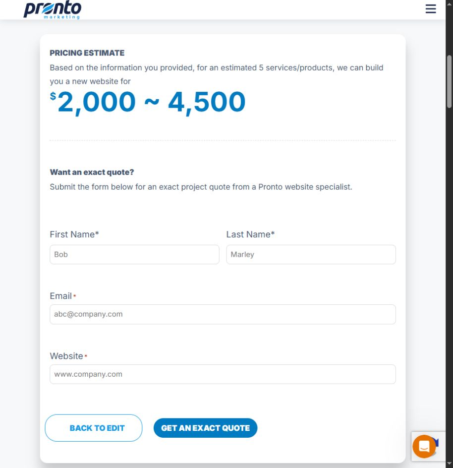
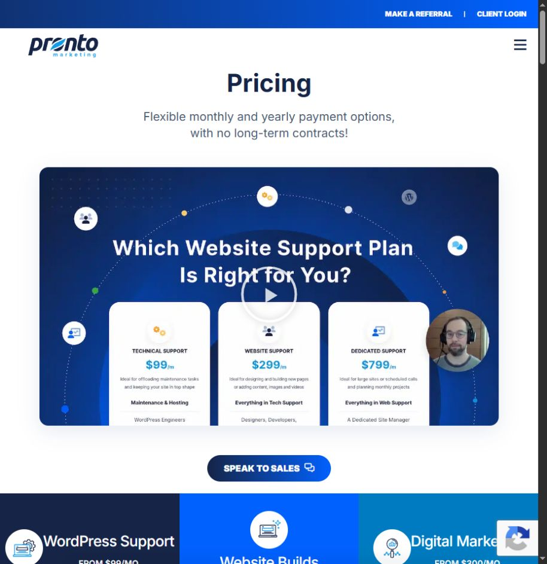
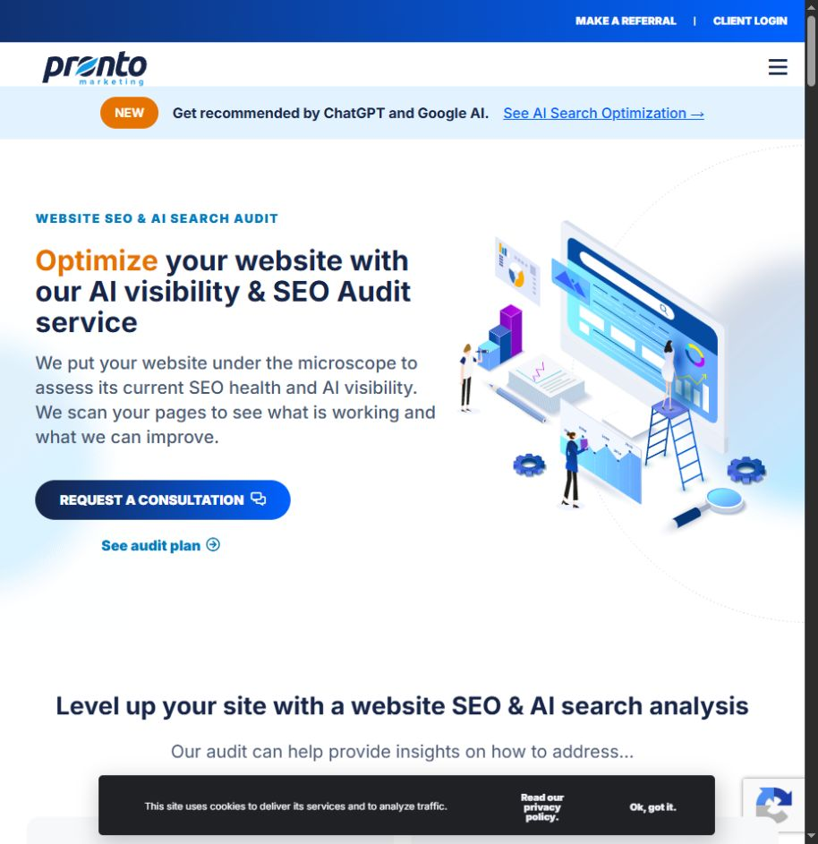

# Pronto Marketing discovery

> Reference evidence (2026-10-23). For current product decisions and instructions, start with [the workspace documentation](../../../README.md). Observations, recommendations and vendor claims retain the qualifications below.

Reviewed October 23, 2026. Page-level observations are in `PAGE_REVIEW.md`; exact coverage in `coverage.json`. Browser inspection included pricing, the SEO audit offer and a completed calculator estimate. No contact details were entered or lead request submitted.

## Core lesson

Pronto offers the strongest directly verified reference here for separating free decision support from a sales request. Its [website calculator](https://www.prontomarketing.com/website-cost-calculator/) produced a result before asking for contact details. It also distinguishes website projects, ongoing support and marketing services instead of treating them as one indistinct subscription.

## Calculator walkthrough

1. Arrive at a page about website cost, with a prominent calculator action.
2. Enter a number of products/services and select content, SEO and commerce requirements.
3. Request the estimate without a name, email or phone.
4. Read the resulting range.
5. Optionally provide first/last name, email and website for an exact quote.

Test case: five services/products, copywriting selected, SEO selected, no ecommerce. Observed output: **$2,000–$4,500**. This is a test of the competitor's interaction, not a comparable Biz Da Vinci price or a commitment from Pronto. Placeholder names visible in the screenshot are the site's placeholders; no identity was entered.

The tool initially rendered without its form in the browser, then loaded as the page initialized. This was a transient observation, not proof of a persistent defect. The decisive result above was verified after interaction.

## What works

- A result is accessible before the exact-quote form.
- The questions describe business scope rather than asking visitors to choose an implementation stack.
- The result is a range, preserving uncertainty.
- Educational cost factors and case-study links help explain the decision.
- [Pricing](https://www.prontomarketing.com/pricing/) separates support, website builds and marketing. Observed support tiers: $99, $299 and $799 per month; advertised build range: $4,500–$15,000+. The calculator's lower example range is a different surface, so it needs explanation rather than silently treating both as the same offer.

## Friction and qualifications

- The calculator page is long, with extensive educational copy around the actual task.
- Product/service count is an imperfect proxy for site complexity. A multi-location practice and a small salon can share a count while needing different workflows.
- The estimate gives a range but a local owner may still need a breakdown of assumptions and recurring costs.
- The large service catalog creates many similar-sounding support/maintenance/management choices. Biz Da Vinci should route by the owner's desired outcome first.
- The [website SEO audit](https://www.prontomarketing.com/website-seo-audit-service/) is a paid offer with displayed $300/$400/$500 options and optional on-page work, not a free immediate audit. A free consultation must not be confused with free analysis.

## Biz Da Vinci adoption

Adopt result-first estimating and separate optional exact-quote contact. Add explicit assumptions, one-time/ongoing costs and a short explanation of what changes the range. Keep a consistent price configuration across calculator, plan cards and proposals. Use the project-plus-care distinction, but simplify navigation to the three questions owners bring.

Provide more useful value in the initial website check than a consultation invitation. A deeper manual audit can be a separate service, with scope and price made explicit. Never call a paid report free because the preliminary call is free.

## Limits

Only one calculator scenario was executed. Its formula, edge cases, delivered services and account portal were not audited. Case-study metrics are attributed vendor claims. Reading service terms is commercial-scope research, not legal advice. The full blog, all location pages and every FAQ answer are outside the detailed review; see the coverage register.
