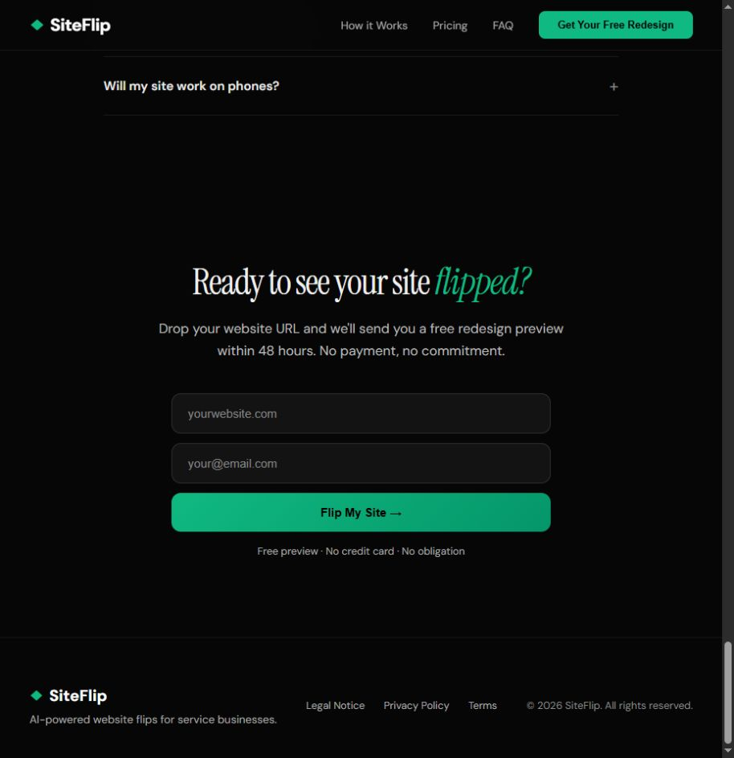

# SiteFlip discovery

> Reference evidence (2026-10-23). For current product decisions and instructions, start with [the workspace documentation](../../../README.md). Observations, recommendations and vendor claims retain the qualifications below.

Reviewed October 23, 2026. Public customer journey and all four discovered public pages. Homepage inspected in the browser; request CTA followed to its form without submitting. Source content retrieved live. Findings are design judgments, not measured conversion results.

## Journey and page-by-page findings

| Page / step | Observed offer or behavior | What works | Friction / limitation | Biz Da Vinci decision |
|---|---|---|---|---|
| [Home](https://www.siteflip.app/) — arrival | Existing-site redesign for trades, with a free preview before paid delivery. HVAC/plumbing qualification in the hero. | A tangible outcome is easier to understand than a broad agency service list. | The headline implies the visitor's site is already redesigned, but the general request flow promises a preview later. | Say what actually exists: an instant concept, or an already prepared preview for that business. |
| Home — comparison | Interactive before/after illustration uses an Acme HVAC example. | Makes design improvement visible without requiring technical knowledge. | The illustrated business and performance scores are not evidence of results for the visitor. | Label examples and concepts; explain the changes beneath the comparison. |
| Home — process | Find business → preview → owner review → paid launch. | Separates deciding from committing. | Automated instant delivery is not demonstrated. | Reuse the sequence, with honest generation/progress states. |
| Home — pricing | Starter $997 once, up to 5 pages; Growth $197/month, up to 7 pages; Scale $497 setup + $147/month, unlimited pages. | Public prices and concrete allowances reduce uncertainty. | Scale costs less per month despite more scope; comparing totals requires arithmetic. Twelve months: Growth $2,364; Scale $2,261 before tax. This is arithmetic from advertised prices, not an offer comparison including all conditions. | Show setup, monthly, minimum term and total commitment together. Do not adopt these prices as our economics. |
| Home — FAQ | Explains update scope, ownership, launch timing and phones. | Answers operational objections near purchase. | The homepage's export language is less specific than subscription source-code terms. | Publish explicit ownership and exit rules next to plans. |
| Home — request | CTA scrolls to website URL and email fields; delivery promised within 48 hours. | Short form and clear timing. | It is a request-and-wait experience, not an immediate result. | URL-first on-screen value; optional email only after the result. |
| [Terms](https://www.siteflip.app/terms) | Distinguishes preview from paid contract; subscriptions provide a license, with source purchase on cancellation at an agreed fee. Change limits exclude larger features. | Delivery boundaries are documented. | Exit fee is not quantified; broad homepage ownership language could be misunderstood. | Define preview limits, paid delivery, ownership, exports and excluded work in plain language. |
| [Privacy](https://www.siteflip.app/privacy) | Says URL is collected and personal information only if voluntarily provided; describes hosting, storage and retention. | Identifies providers and retention. | Wording does not clearly explain the visible email request or whether it is optional. Requiredness was not tested by submission. | Match policy to actual fields and distinguish report delivery from marketing consent. |
| [Legal notice](https://www.siteflip.app/legal) | Names operator and contact details in Germany. | Establishes an identifiable operator. | Legal page does not substantiate customer-performance claims. | Provide real operator identity, contact and service area; avoid importing legal text. |

## Proof quality

Homepage reports lead and speed improvements, and includes a testimonial. They are vendor claims, not independently verified outcomes. The comparison is illustrative. A testimonial portrait resolves to an Unsplash asset; that does not establish the testimonial is false, but it should not be treated as independently authenticated customer evidence. Do not reproduce the claims in Biz Da Vinci.

## Visual observations

Dark background, emerald buttons, large serif headline, limited navigation and a focused request form. The restrained palette and before/after mechanism support the proposition. A full-page capture had large unrendered areas associated with page animation/scroll behavior; it is retained as a capture limitation, not evidence that ordinary users see a broken page. The request viewport below was inspected and accepted.

## Recommended adoption

Adopt the visible transformation and preview-before-purchase sequence. Modify the lead gate into immediate on-screen concept delivery. Define the free deliverable as a bounded concept, not unlimited free production work. Avoid unsupported performance numbers, implied prior work, ambiguous subscription ownership and unpriced exit conditions.

## Coverage

4 unique public pages reviewed. The homepage's process, pricing, FAQ and request are sections, not additional pages. No account, preview generation, delivery email, paid checkout or actual customer outcome was tested. See [page notes](PAGE_REVIEW.md), [URL inventory](url-inventory.json), [coverage](coverage.json) and [retrieval metadata](retrieval-metadata.json). Full competitor pages are not republished.
