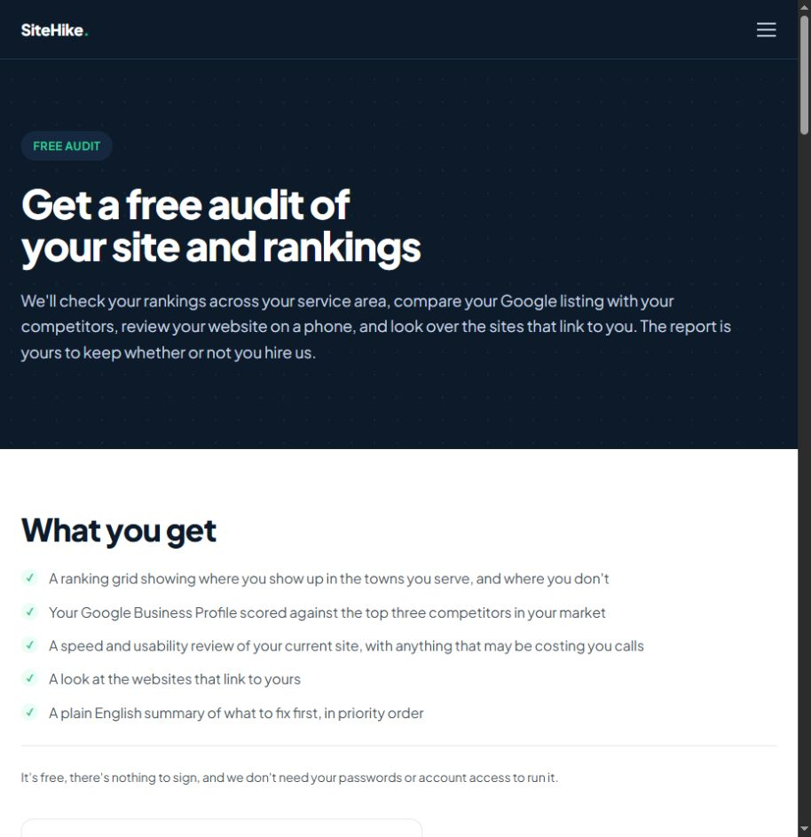
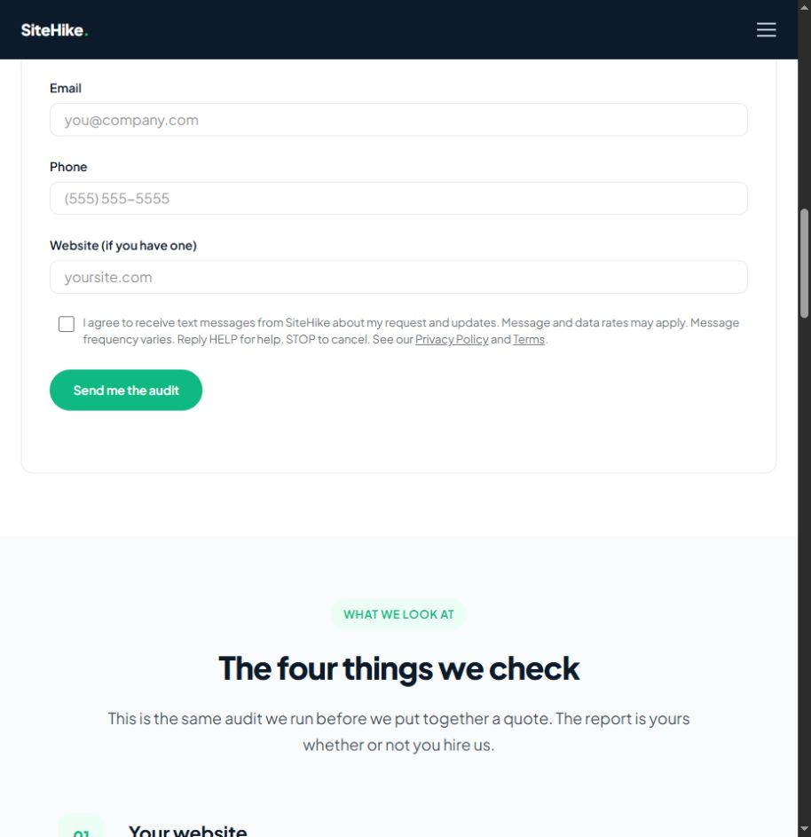
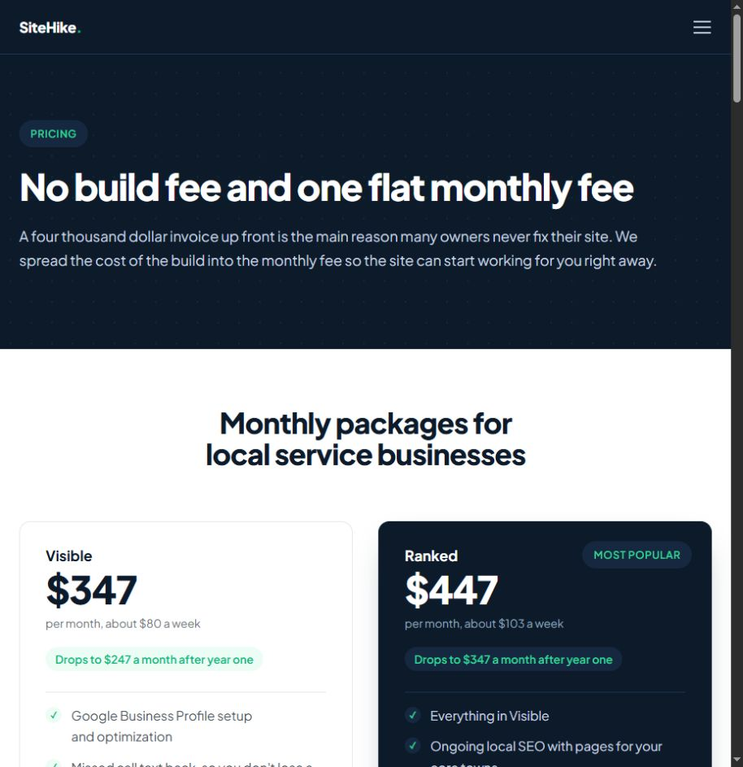

# SiteHike discovery

> Reference evidence (2026-10-23). For current product decisions and instructions, start with [the workspace documentation](../../../README.md). Observations, recommendations and vendor claims retain the qualifications below.

Reviewed October 23, 2026. See `PAGE_REVIEW.md` for individual pages and `coverage.json` for retrieval status. Browser evidence includes the audit and pricing pages. Evaluation concerns the public offer and user journey; business results were not independently verified.

## Core lesson

SiteHike connects a website to the local-business workflow: discovery in search, contact, missed-call follow-up, reviews and booked work. This is a useful way to explain why improvements matter. Biz Da Vinci should adopt the customer-outcome framing while staying precise about what its tools actually measure.

## Free audit journey

The [audit offer](https://www.sitehike.com/free-audit) explains concrete deliverables: a local ranking grid, Google profile comparison, phone usability review, backlink review and prioritized fixes. It shows a real ranking-grid example and separately labels a sample report's fictional data. That distinction is good evidence hygiene.

The form asks name, email, phone and an optional website, with a separate SMS-consent checkbox. The report is manually prepared and emailed in about two business days. No request was submitted, so actual turnaround and report quality remain untested. The free deliverable is useful in scope but gated and delayed, whereas Biz Da Vinci requires on-screen value first.

1. Explain what will be checked.
2. Show a sample so owners understand the deliverable.
3. Request contact information.
4. Deliver a written report later.
5. Offer a review call.

For Biz Da Vinci, move useful output ahead of step 3. Do not promise ranking grids or Google-profile scoring until real data collection supports them; current Repo Brain audit code does not establish this capability.

## Pricing and recurring work

The [pricing page](https://www.sitehike.com/pricing) shows Visible $347/month, Ranked $447 and Booked $697. Plans run 12 months; the displayed rates drop by $100/month after year one. Webflow hosting is separately billed at $300/year. Site ownership follows 12 payments; domain and Google profile are described as belonging to the client from day one. Non-trade projects are quoted separately.

Calculated first-year base plan totals, before hosting/tax/extras, are $4,164, $5,364 and $8,364. These are arithmetic from displayed prices, not Biz Da Vinci recommendations. Include the separate hosting fee when comparing total cost.

The cards differentiate foundational visibility, ongoing SEO, and more follow-up/content/ads work. This is more meaningful than only changing page counts. However, “one flat monthly fee” needs the nearby hosting qualification, and paid-ad management must not be confused with ad spend. Our product should show all recurring components in one place.

## What works

- Specific audit outputs, examples and a clear explanation of why the audit is free.
- Plain-language emphasis on calls, appointments and follow-up rather than purely visual redesign.
- Ownership and post-term rate explained on the pricing page.
- A stated willingness to start with a smaller service when a full plan is unnecessary.
- Industry and work pages support relevance without putting every service into the hero.

## What to change for Biz Da Vinci

- Deliver a useful initial result without name, email or phone.
- Keep the hero's three intents concise; deeper service menus can appear after the result.
- Explain what is observed, inferred and unavailable in an audit.
- Preserve multiple professions; use goal-based variations such as booking, estimates, orders and visits.
- Define operating scope for SEO, follow-up and ongoing care instead of presenting every capability as universally included.

## Limits

No audit request, SMS opt-in, booked call, signup, account login or payment was submitted. Third-party review authenticity, actual rankings and service outcomes were not independently checked. The broader indexed archive is not all visually audited. This report's strengths and weaknesses are reasoned design findings, not measured conversion lift.
