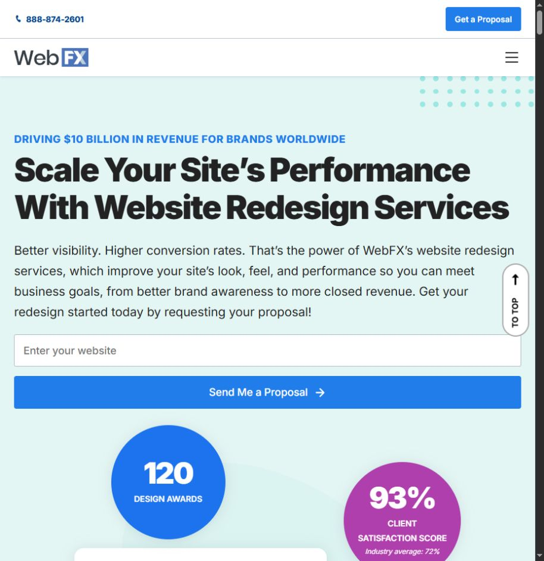
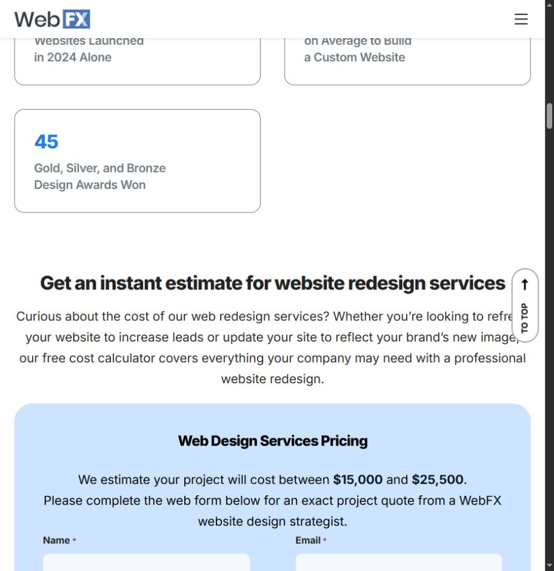

# WebFX discovery

> Reference evidence (2026-10-23). For current product decisions and instructions, start with [the workspace documentation](../../../README.md). Observations, recommendations and vendor claims retain the qualifications below.

Reviewed October 23, 2026, starting with the supplied [website redesign page](https://www.webfx.com/web-design/services/redesign/). Detailed page register: `PAGE_REVIEW.md`; retrieval coverage: `coverage.json`. This is a focused study of the redesign buying journey and connected proof/services, not a claim to have audited WebFX's entire large website.

## Core lesson

WebFX treats redesign as a business project: scope, ownership, implementation, measurement and case evidence. It also has an ungated estimate calculator. Biz Da Vinci can borrow that clarity and proof structure while substantially reducing the amount of material a small-business owner must navigate.

## Redesign page journey

1. Performance-oriented promise and website field leading to a proposal.
2. Portfolio examples and delivery/experience claims.
3. An interactive cost calculator.
4. Detailed service scope and technology explanations.
5. Case studies, comparisons and FAQs.
6. Repeated proposal calls to action.

The depth answers many procurement questions, but it is a long path for someone who only wants to know what is wrong with a local-business site. The hero is primarily a proposal entrance; free utility appears farther down.

## Calculator verification

Selected 1–10 pages, responsive design, simple style, basic database integration, 5–10 copywriting pages, basic ecommerce, the displayed SEO option 30, and standard CMS. The page displayed **$15,000–$25,500** before requesting name, email, phone, company and website. No contact information or proposal was submitted.

This is a bundled test scenario, not a basic brochure-site quote and not a comparison with Pronto's different inputs. The separate page claim that custom designs start at $8,000 is also a different scope statement.

What works: a visible range, a recorded specification in the quote-details area, and a clear transition from estimate to exact proposal. What could be simpler for our audience: CMS/database tiers and numeric SEO options demand technical knowledge. Biz Da Vinci should ask about booking, orders, service coverage and content readiness, then derive the implementation needs internally.

## Evidence and scope

The redesign page ties named client stories to goals and outcomes, rather than relying only on attractive screenshots. It describes end-to-end design/development, optimization, launch and ongoing support, and explicitly says clients own their websites. These are useful decision aids.

Treat all results, review counts, awards and revenue figures as WebFX's claims. We did not access the underlying analytics or verify attribution. A redesign accompanied by SEO, ads and other changes does not isolate the causal effect of design.

For Biz Da Vinci case studies, show: business type → starting problem → changes made → measurement period → observed outcome → attribution limits. If the work is only a concept, say so and omit invented improvement metrics.

## What to adopt and avoid

- Adopt explicit deliverables, ownership answers, process expectations and named examples with context.
- Adopt ungated estimating, using simpler owner-language inputs.
- Put our free utility near the top instead of after extensive proof and portfolio sections.
- Keep deeper procurement details accessible on dedicated pages, not all on the homepage.
- Do not inherit enterprise-scale scope, technical jargon, unsupported ranking guarantees or competitor-comparison generalizations.
- Avoid implying that Biz Da Vinci has WebFX's staff, history, tooling or proven results.

## Limits

The global URL map reached its 300-result cap and is not a complete site inventory. Only the specified redesign/services/pricing/case-study journey was selected for detailed review. One calculator combination was verified; no proposal, account, purchase or customer delivery was tested. Screenshot observations are from the research browser viewport, not comprehensive responsive/accessibility testing.
